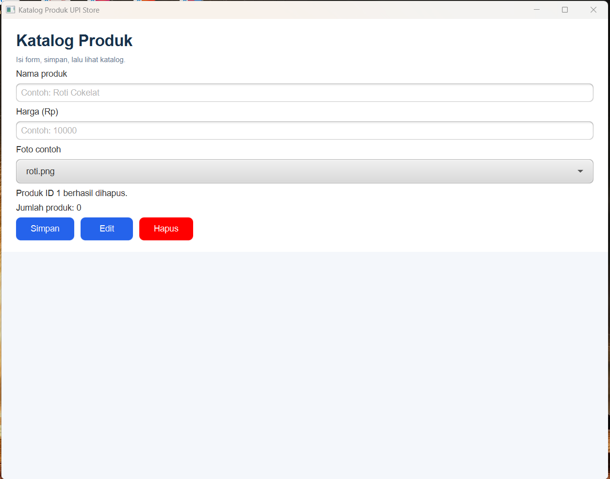
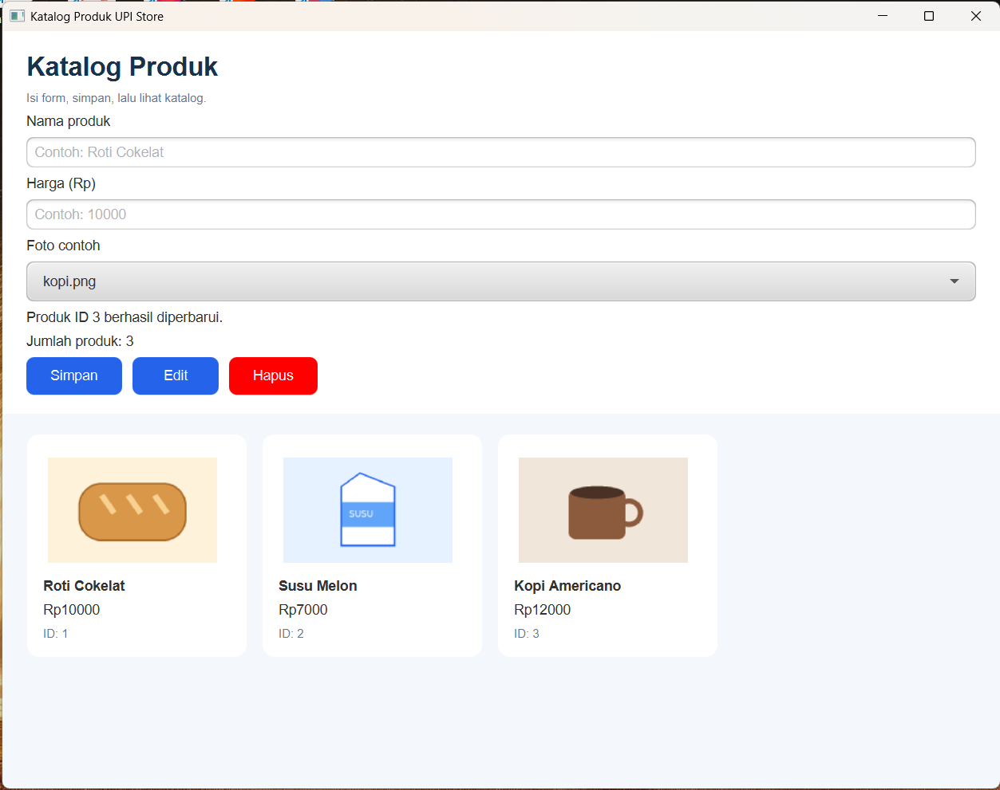

# KatalogProduk — Aplikasi Katalog Toko Modern


Aplikasi desktop manajemen katalog produk berbasis **JavaFX** yang dirancang menggunakan pendekatan **Object-Oriented Programming (OOP)** dan arsitektur **MVC (Model-View-Controller)**. Menggunakan **SQLite** sebagai basis data relasional lokal yang ringan, cepat, dan aman.

---

## Fitur Utama

* **Full CRUD (Create, Read, Update, Delete)**
  * **Create:** Menambahkan produk baru lengkap dengan nama, harga, dan aset gambar.
  * **Read:** Menampilkan daftar produk secara dinamis dalam tata letak kartu (*card*) responsif menggunakan `TilePane`.
  * **Update:** Mengubah data produk yang sudah ada cukup dengan memilih kartu produk pada katalog.
  * **Delete:** Menghapus produk dari basis data SQLite dengan pembaruan tampilan secara *real-time*.
* **Keamanan Basis Data (`PreparedStatement`):** Mencegah celah keamanan *SQL Injection* pada setiap operasi kueri basis data.
* **Manajemen Aset Gambar:** Mendukung pemilihan dan pratinjau file gambar produk secara visual.
* **Arsitektur Modular (MVC):** Pemisahan tanggung jawab kode yang bersih antara koneksi database (`db`), akses data (`data`), entitas model (`model`), dan logika antarmuka (`controller`).

---

## Tampilan Antarmuka (UI Preview)

<p align="center">
  
  
</p>

---

## Tech Stack

| Komponen | Teknologi | Keterangan |
| :--- | :--- | :--- |
| **Bahasa Pemrograman** | Java (JDK 17+) | Inti logika aplikasi berbasis OOP |
| **Framework GUI** | JavaFX | Antarmuka desktop modern & komponen `TilePane` |
| **Basis Data** | SQLite (`sqlite-jdbc`) | Penyimpanan data lokal relasional |
| **Build & Dependensi** | Apache Maven | Manajemen pustaka dan kompilasi proyek |

---

## Struktur Proyek

```text
src/main/java/
├── db/
│   └── Database.java           # Pengatur koneksi dan inisialisasi tabel SQLite
├── data/
│   └── ProdukRepository.java   # Logika kueri SQL (INSERT, SELECT, UPDATE, DELETE)
├── model/
│   └── Produk.java             # Kelas entitas/objek data produk
├── controller/
│   └── KatalogController.java  # Pengendali logika UI (TilePane, Form, Event)
└── MainApp.java                # Titik masuk utama (entry point) aplikasi

```

## Cara Menjalankan Proyek

**1. Prasyarat**

- JDK 17 atau versi lebih baru sudah terpasang di sistem Anda.

- Apache Maven (sudah terintegrasi di sebagian besar IDE modern).

- IDE Java yang mendukung proyek Maven dan JavaFX (seperti NetBeans, IntelliJ IDEA, atau VS Code).

**2. Langkah Instalasi & Eksekusi**
Kloning atau Buka Proyek

```bash
git clone [https://github.com/username/KatalogProduk.git](https://github.com/username/KatalogProduk.git)
cd KatalogProduk
```

**Unduh Dependensi & Build**
Jalankan Clean and Build pada IDE, atau gunakan perintah berikut melalui terminal:
```bash
mvn clean install
```
**Jalankan Aplikasi**
Jalankan kelas MainApp.java melalui IDE, atau eksekusi melalui Maven:

```bash
mvn javafx:run
```
Catatan: Pada saat aplikasi pertama kali dijalankan, file basis data katalog.db beserta tabelnya akan dibuat secara otomatis di dalam folder data/ pada direktori proyek Anda.